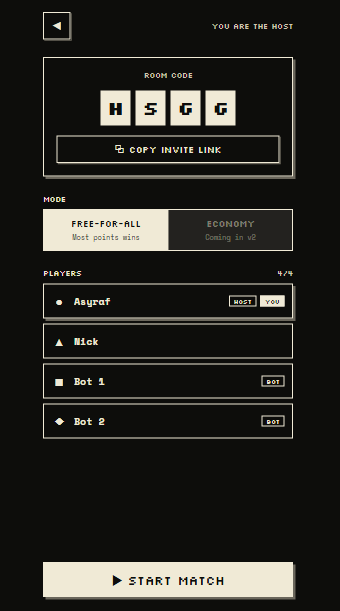
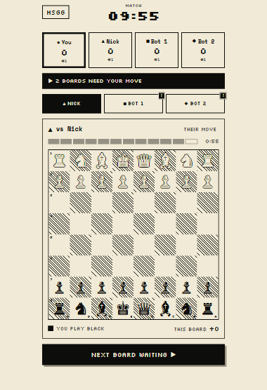

# Desperado Chess — Frontend

A party chess web app. Everyone in the room plays everyone else at the same time, on separate boards, for 10 minutes. Captures score points, checkmates score a bonus, and the current leader is worth double.

**Live demo:** (to be deployed ASAP)
**Backend repo:** https://github.com/asycodes/desperado-chess-backend

<p align="center">
  
</p>

---

## Screenshots

| Home | Lobby | Match start |
|:---:|:---:|:---:|:---:|
|  |  |  | 
| Enter a name, then create a room or join with a 4-letter code | Share the code, fill empty seats with bots, choose the mode | One board per opponent; tabs mark boards waiting for your move |

---

## How the game works (v1)

| Rule | Detail |
|---|---|
| Format | Round-robin simul. Every pair of players shares one board (4 players → 6 boards, 3 per player). |
| Match length | 10 minutes for the whole match. |
| Move timer | 60 seconds per move. On timeout the turn passes to the opponent. If you time out while in check, it counts as checkmate. |
| Points | Pawn 1, Knight 3, Bishop 3, Rook 5, Queen 9, Checkmate +15. |
| Leader bounty | Capturing from the single top scorer is worth ×2 (capture points only). |
| After checkmate or draw | The board restarts with colours swapped. |
| Bots | The host can fill empty seats with bots. Bot-vs-bot boards play in the background and count toward bot scores. |

Your own pieces are always drawn at the bottom of each board.

---

## Features

**Done**
- Create a room with a nickname, or join with a 4-letter code (invite links pre-fill the code)
- Lobby with live player updates over WebSocket (STOMP)
- Host controls: add bots to empty seats, choose the mode, start the match
- Live match screen: all your boards, per-move timers, match clock, scoreboard, leader bounty badge
- Phone layout with board tabs and a "next board waiting" button; desktop layout shows all boards side by side
- Tap-to-move board with legal-move hints, capture markers, check indicator and coordinates
- Final standings with tie handling
- 1-bit "Ink & Eggshell" pixel theme (no colour; state shown by fill, inversion and shape marks ● ▲ ■ ◆)
- Unit and component tests (Vitest + React Testing Library)
- CI on every pull request: type check, tests, build

**Planned**
- Leave-room button (needs a backend endpoint)
- Match history page (needs persisted matches on the backend)
- Promotion picker (v1 always promotes to a queen)
- Read the move timeout from the server instead of a frontend constant
- Pixel-art chess pieces to match the theme
- v2: spectate other boards, online matchmaking, Economy mode

---

## Tech stack

| Area | Choice |
|---|---|
| Framework | React 19, React Router v7 (framework mode, SPA: `ssr: false`) |
| Language | TypeScript |
| State | Redux Toolkit; RTK Query for server data |
| Real-time | `@stomp/stompjs` over WebSocket, wired into RTK Query with `onCacheEntryAdded` |
| Chess logic | `chess.js` (legal moves and board state from FEN; the server is still the authority) |
| Styling | Tailwind CSS v4 with CSS-variable theme tokens |
| Testing | Vitest, React Testing Library, jest-dom, user-event |
| CI | GitHub Actions |

---

## How it talks to the backend

```
 Browser                                   Spring Boot backend
 ───────                                   ───────────────────
 RTK Query mutation ── REST (POST) ──────▶ validate, update state
                                                    │
 RTK Query cache  ◀── STOMP /topic/... ─── broadcast new snapshot
 (updateCachedData)                        (after the DB commit)
```

- **Commands go over REST** (create room, join, add bot, start, make move), so each one gets a normal HTTP status and error message.
- **State comes back over WebSocket.** The page subscribes to `/topic/rooms/{code}` or `/topic/matches/{code}` and replaces its cached copy with each new snapshot.
- The server sends absolute deadlines (`endsAtEpochMs`, `turnDeadlineEpochMs`), and the client only counts down to them, so all players see the same clock.

---

## Project structure

```
app/
  components/        Shared UI (PixelKnight, SegmentedTimer)
  features/
    room/            Create/join forms, room API (RTK Query endpoints)
    lobby/           RoomCodeCard, PlayerList
    match/           ChessBoard, BoardCard, Scoreboard, match API
    session/         sessionSlice (who you are in which room, saved to sessionStorage)
  lib/               api.ts (base API), stomp.ts, errors.ts, useNow.ts, ranking.ts
  routes/            home, lobby, match
  store/             Redux store and typed hooks
  types/             API and match types, player marks
  app.css            Theme tokens and pixel utilities
```

---

## Running locally

**Prerequisites:** Node (version in `.nvmrc`) and the [backend](https://github.com/YOUR-USERNAME/desperado-backend) running on port 8080.

```bash
npm ci
cp .env.example .env      # then edit if your backend runs elsewhere
npm run dev               # http://localhost:5173
```

### Environment variables

| Variable | Example | Purpose |
|---|---|---|
| `VITE_API_URL` | `http://localhost:8080` | Backend base URL, without a trailing slash. The WebSocket URL is derived from it (`http` → `ws`, plus `/ws`). |

Vite reads these at **build time**, so after changing one in a hosting dashboard you need to redeploy.

### Scripts

| Command | What it does |
|---|---|
| `npm run dev` | Dev server with hot reload |
| `npm run typecheck` | Generate route types and run `tsc` |
| `npm test` | Vitest in watch mode |
| `npm run test:run` | Vitest once (used in CI) |
| `npm run build` | Production build to `build/client` |

---

## Deployment

The app is a static SPA, deployed on Vercel:

- Build command `npm run build`, output directory `build/client`
- `vercel.json` rewrites every path to `index.html`, so links like `/room/ABCD` work on refresh
- `VITE_API_URL` is set to the deployed backend URL

---

## Known limitations

- Player identity is a `playerId` kept in `sessionStorage`; there is no authentication yet (planned: guest tokens).
- The free backend sleeps after 15 minutes without traffic, and a running match is lost if it restarts (matches are kept in memory).
